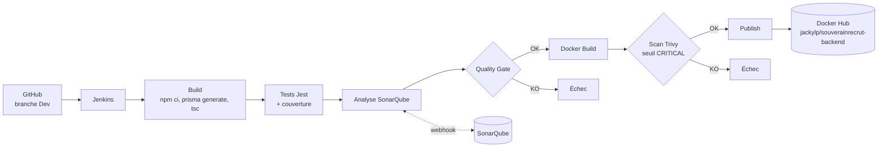
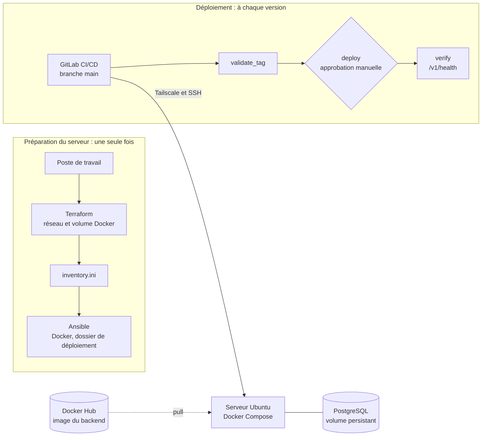

# Architecture de la chaîne CI/CD

## Vue d'ensemble

Chaque étape ne s'exécute que si la précédente a réussi : la publication sur Docker Hub est donc conditionnée à la réussite des tests, du Quality Gate et du scan Trivy.

## Composants

| Composant | Rôle | Emplacement |
|---|---|---|
| GitHub | Dépôt source ; le job Jenkins récupère la branche `Dev` | Dépôt GitHub du projet |
| Jenkins | Orchestration de la pipeline | Conteneur Docker `souverainrecrut-jenkins`, port 8080 |
| Jest + supertest | Exécution des tests automatisés et mesure de la couverture (rapport `lcov.info`) | Étape *Test* |
| SonarQube | Analyse qualité, Quality Gate | http://localhost:9000 |
| Docker | Construction de l'image applicative | Étape *Docker Build* |
| Trivy 0.74.0 | Analyse de vulnérabilités de l'image | Image `aquasec/trivy` épinglée par digest |
| Docker Hub | Registre de l'image versionnée | Dépôt `jackylp/souverainrecrut-backend` |

## Choix d'architecture

**Jenkins dans Docker, accès Docker de l'hôte.** Jenkins monte le socket Docker de l'hôte (`/var/run/docker.sock`) et embarque uniquement le CLI Docker. Les étapes de build n'exécutent donc pas d'outils installés dans Jenkins : elles lancent des conteneurs éphémères (`node:22-bookworm-slim`, `sonar-scanner-cli`, `trivy`). Cela rend le build reproductible et évite d'installer Node ou le scanner dans l'image Jenkins. Contrepartie : le conteneur Jenkins tourne en `root` pour accéder au socket, ce qui convient à un environnement local de TP mais pas à de la production.

**Partage du workspace.** Comme le démon Docker est celui de l'hôte, un montage `-v $WORKSPACE:...` pointerait vers un chemin inexistant côté hôte. Les conteneurs de build utilisent donc `--volumes-from souverainrecrut-jenkins`, qui réutilise le volume du conteneur Jenkins au même chemin.

**Quality Gate par webhook.** Le scanner envoie l'analyse à SonarQube ; SonarQube appelle `/sonarqube-webhook/` sur Jenkins une fois l'analyse traitée ; `waitForQualityGate` attend ce retour (5 minutes maximum) et fait échouer la pipeline si le verdict n'est pas `OK`. Le scanner écrit son répertoire de travail dans le workspace (`-Dsonar.working.directory`), faute de quoi Jenkins ne retrouve pas le fichier `report-task.txt`.

**Trivy en deux passes.** Une première passe produit un rapport JSON complet (HIGH et CRITICAL), archivé dans le build. Une seconde passe est bloquante : elle échoue si une vulnérabilité **CRITICAL** disposant d'un correctif est présente (`--severity CRITICAL --ignore-unfixed --exit-code 1`). L'image de Trivy est épinglée par digest (jamais `latest`).

**Tags de l'image.** Chaque image est publiée sous le numéro de build Jenkins (ex. `8`) et sous `latest`.

## Chaîne de déploiement

### Vue d'ensemble

Le serveur est préparé avant, depuis le poste de travail. Le pipeline GitLab ne s'occupe que du déploiement d'une version. L'image n'est jamais reconstruite : le serveur télécharge celle que Jenkins a publiée.

### Composants

| Composant | Rôle | Emplacement |
|---|---|---|
| Terraform | Crée le réseau `souverainrecrut-net` et le volume `souverainrecrut-postgres-data`, génère l'inventaire Ansible | `deploiement/terraform/`, lancé depuis le poste de travail |
| Ansible | Met à jour le serveur, vérifie Docker et Compose, crée `~/deployment` | `deploiement/ansible/` |
| GitLab CI/CD | Valide le tag, déploie après approbation, vérifie l'API | `deploiement/.gitlab-ci.yml`, runner partagé de gitlab.com |
| Tailscale | Réseau privé entre le runner GitLab, le poste de travail et le serveur | Un nœud éphémère par job, créé avec `TS_AUTHKEY` |
| Docker Compose | Orchestre le backend, PostgreSQL et le conteneur de migration | `deploiement/deployment/docker-compose.yml`, copié dans `~/deployment` |
| PostgreSQL 16 | Base de données, image officielle `postgres:16-alpine` | Service `postgres`, volume persistant |

### Choix d'architecture

**Terraform sans hyperviseur.** Le serveur existe déjà : il n'y a pas d'ESXi ni de vCenter pour créer une machine virtuelle. Terraform pilote donc le Docker du serveur à distance, en SSH, avec le provider `kreuzwerker/docker`, et gère les ressources qui existent vraiment : un réseau et un volume. L'état (`terraform.tfstate`) est local et hors du dépôt, ce qui explique que Terraform ne tourne pas dans le pipeline GitLab.

**Provisionnement hors du pipeline.** Terraform et Ansible se lancent depuis le poste de travail, une seule fois. Les mettre dans le pipeline demanderait un état Terraform partagé et le mot de passe `sudo` du serveur. Le pipeline GitLab reste limité au déploiement.

**Accès au serveur par Tailscale.** Le serveur n'est pas exposé sur internet. Le runner partagé de gitlab.com rejoint le réseau privé avec Tailscale en mode `userspace-networking` (sans droits root sur la machine) et passe par `tailscale nc` comme commande de proxy SSH. La clé d'authentification est éphémère : le nœud disparaît à la fin du job.

**Version figée et approbation manuelle.** Le pipeline refuse le tag `latest`, vérifie que le tag existe sur Docker Hub, puis attend un clic sur `deploy`. On sait toujours quelle version tourne, et revenir en arrière consiste à relancer le pipeline avec l'ancien tag.

**Réseau et volume externes.** Le compose les déclare en `external: true` : ils appartiennent à Terraform. Un `docker compose down` ne supprime donc pas les données PostgreSQL.

**Migrations Prisma.** Le CLI Prisma n'est pas dans l'image du backend. Un conteneur `node:22` éphémère (profil `migrate` du compose) lit le dossier `prisma/` copié par le pipeline et lance `prisma migrate deploy`, avant le démarrage du backend.

**Santé et redémarrage.** PostgreSQL et le backend ont un contrôle de santé. Le backend ne démarre qu'une fois PostgreSQL sain. Les deux services redémarrent automatiquement (`unless-stopped`).

**Clé SSH en base64.** La clé privée de déploiement est stockée sur une seule ligne en base64 dans une variable GitLab de type *Variable*. Les clés multilignes sont déformées à la copie, et le type *File* donne un chemin au lieu de la valeur.

## Gestion des secrets

Aucun secret n'est dans le dépôt. Jenkins stocke deux credentials (`sonar-token`, `dockerhub-credentials`) et les injecte à l'exécution avec `withSonarQubeEnv` et `withCredentials`. La session `docker login` utilise un dossier de configuration temporaire supprimé en fin d'étape.

Pour le déploiement, les secrets (clé SSH, clé Tailscale, token Docker Hub, accès PostgreSQL, secret JWT) sont des variables GitLab CI/CD, masquées dans les logs. Le pipeline en tire le fichier `.env` du serveur, créé avec les droits `600`. Les fichiers `terraform.tfvars`, `terraform.tfstate` et tout `.env` réel sont exclus par le `.gitignore`.
