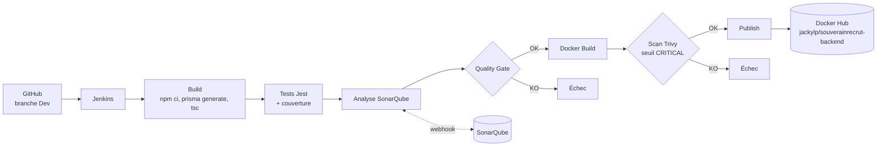

# Architecture de la chaîne CI/CD

## Vue d'ensemble

Chaque étape ne s'exécute que si la précédente a réussi : la publication sur Docker Hub est donc conditionnée à la réussite des tests, du Quality Gate et du scan Trivy.

## Composants

| Composant | Rôle | Emplacement |
|---|---|---|
| GitHub | Dépôt source ; le job Jenkins récupère la branche `Dev` | Dépôt GitHub du projet |
| Jenkins | Orchestration de la pipeline | Conteneur Docker `souverainrecrut-jenkins`, port 8080 |
| Jest + supertest | Exécution des tests automatisés et mesure de la couverture (rapport `lcov.info`) | Étape *Test* |
| SonarQube | Analyse qualité, Quality Gate | http://localhost:9000 |
| Docker | Construction de l'image applicative | Étape *Docker Build* |
| Trivy 0.74.0 | Analyse de vulnérabilités de l'image | Image `aquasec/trivy` épinglée par digest |
| Docker Hub | Registre de l'image versionnée | Dépôt `jackylp/souverainrecrut-backend` |

## Choix d'architecture

**Jenkins dans Docker, accès Docker de l'hôte.** Jenkins monte le socket Docker de l'hôte (`/var/run/docker.sock`) et embarque uniquement le CLI Docker. Les étapes de build n'exécutent donc pas d'outils installés dans Jenkins : elles lancent des conteneurs éphémères (`node:22-bookworm-slim`, `sonar-scanner-cli`, `trivy`). Cela rend le build reproductible et évite d'installer Node ou le scanner dans l'image Jenkins. Contrepartie : le conteneur Jenkins tourne en `root` pour accéder au socket, ce qui convient à un environnement local de TP mais pas à de la production.

**Partage du workspace.** Comme le démon Docker est celui de l'hôte, un montage `-v $WORKSPACE:...` pointerait vers un chemin inexistant côté hôte. Les conteneurs de build utilisent donc `--volumes-from souverainrecrut-jenkins`, qui réutilise le volume du conteneur Jenkins au même chemin.

**Quality Gate par webhook.** Le scanner envoie l'analyse à SonarQube ; SonarQube appelle `/sonarqube-webhook/` sur Jenkins une fois l'analyse traitée ; `waitForQualityGate` attend ce retour (5 minutes maximum) et fait échouer la pipeline si le verdict n'est pas `OK`. Le scanner écrit son répertoire de travail dans le workspace (`-Dsonar.working.directory`), faute de quoi Jenkins ne retrouve pas le fichier `report-task.txt`.

**Trivy en deux passes.** Une première passe produit un rapport JSON complet (HIGH et CRITICAL), archivé dans le build. Une seconde passe est bloquante : elle échoue si une vulnérabilité **CRITICAL** disposant d'un correctif est présente (`--severity CRITICAL --ignore-unfixed --exit-code 1`). L'image de Trivy est épinglée par digest (jamais `latest`).

**Tags de l'image.** Chaque image est publiée sous le numéro de build Jenkins (ex. `8`) et sous `latest`.

## Gestion des secrets

Aucun secret n'est dans le dépôt. Jenkins stocke deux credentials (`sonar-token`, `dockerhub-credentials`) et les injecte à l'exécution avec `withSonarQubeEnv` et `withCredentials`. La session `docker login` utilise un dossier de configuration temporaire supprimé en fin d'étape.
