# Rapport final : SouverainRecrut CI/CD

Je travaille uniquement sur le backend (API Node.js, Express, TypeScript, Prisma, PostgreSQL), comme le demande le cahier des charges.

## Objectif

Mettre en place une chaîne complète, du code jusqu'au déploiement de l'API sur un serveur :

1. le code du backend est testé et analysé (tests, SonarQube, Quality Gate) ;
2. une image Docker est construite, scannée avec Trivy et publiée sur Docker Hub, seulement si tous les contrôles passent ;
3. cette image est récupérée par GitLab CI/CD et déployée sur un serveur Ubuntu préparé avec Ansible (et Terraform si c'est possible).

Le but n'est pas seulement d'avoir une API qui marche, mais un processus automatisé, reproductible, sécurisé, traçable et documenté. La partie 1 couvre les étapes 1 et 2, la partie 2 couvre l'étape 3.

## Environnement utilisé

Je note ici les machines et les versions que j'ai utilisées, pour que tout puisse être rejoué.

**Machine de build (CI)**

| | |
|---|---|
| Machine | MacBook Pro, Apple M4 Pro (arm64), 12 cœurs, 24 Go de RAM, macOS 27.0.1 |
| Docker | Docker Desktop, moteur 29.5.3 (linux/arm64) |
| Jenkins | 2.580.2, image `jenkins/jenkins:lts-jdk21` (Java 21), dans Docker, port 8080 |
| SonarQube | Community Build 26.10, dans Docker, port 9000 |
| Trivy | 0.74.0, image épinglée par digest |
| Node.js | 22 pour le build et les tests (conteneur `node:22-bookworm-slim`) ; le Dockerfile du backend part de `node:20-alpine` |
| Terraform | 1.17.1, lancé depuis le Mac |
| Ansible | core 2.21.6, lancé depuis le Mac |

**Serveur de déploiement**

| | |
|---|---|
| Système | Ubuntu 26.04.1 LTS |
| Architecture | x86_64 (amd64) |
| Ressources | 8 cœurs, 14 Go de RAM, 233 Go de disque (197 Go libres) |
| Docker | déjà installé (29.9.1), passé en 29.9.3 par la mise à jour d'Ansible ; Compose v5.7.0 |
| Accès | SSH, à travers Tailscale |

## Partie 1 : Intégration continue (jour 1)

### 1. Préparation du dépôt

Le dépôt est sur GitHub (`Jacky-Lp/souverainrecrut`), je travaille sur la branche `Dev`. J'installe avec `cd backend`, `npm ci` et `npx prisma generate`.

### 2. État des lieux

Avant de toucher au code, j'ai lancé un premier scan SonarQube :

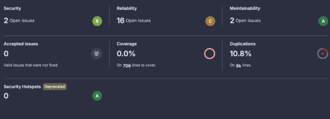

Deux points faibles : **0 % de couverture** (aucun test) et **10,8 % de duplication**. Ce scan analysait tout le dépôt, frontend compris. Les 16 issues de fiabilité étaient toutes dans le frontend, qui est hors périmètre, donc je ne les ai pas corrigées. Les scans suivants ne portent que sur le backend.

### 3. Tests du backend

J'utilise Jest avec ts-jest pour le TypeScript, et supertest pour appeler l'API comme un vrai client HTTP. Prisma est simulé, donc les tests n'ont pas besoin de base de données. Chaque test suit le schéma Arrange / Act / Assert.

**Avant**, le script `npm test` affichait seulement un message et se terminait en succès, sans rien tester :

```
> echo "Jest sera configuré plus tard"
Jest sera configuré plus tard
```

**Après**, il lance 3 suites et **69 tests**, avec 99 % de lignes couvertes selon Jest :

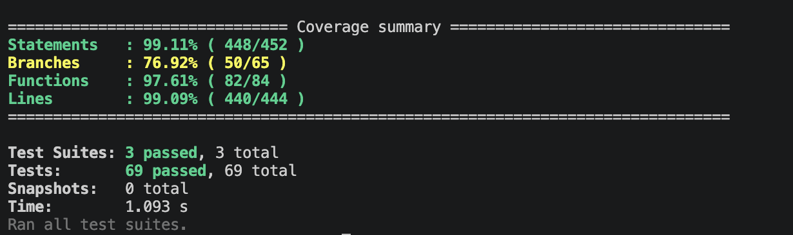

Le rapport HTML de Jest montre la couverture dossier par dossier :

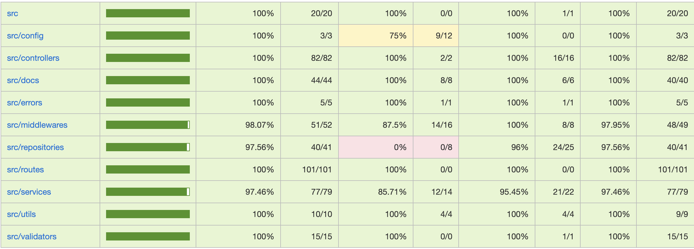

Tout est à 100 % sauf quelques cas : les valeurs par défaut (`src/config` et `src/repositories`), le format de log en production, le cas « pas d'utilisateur » du middleware `authorize`, et `ApplicationService.updateStatus`.

**Pourquoi je m'arrête à 92,6 % (le chiffre de SonarQube) :**

- La couverture mesure ce qui est exécuté, pas ce qui est vérifié. Viser 100 %, c'est écrire des tests pour le chiffre.
- Tout ce que l'API expose est à 100 % : routes, rôles (401, 403), erreurs (400, 404, 409, 500).
- Le reste, c'est du code défensif ou de la configuration. Pour l'atteindre, il faudrait des tests artificiels et fragiles, qui ne protègent aucun vrai comportement.
- Une exception : `updateStatus` n'est appelée par aucune route. Soit c'est du code mort, soit c'est une fonction à exposer. Un test ne règle pas ça, c'est un choix fonctionnel.

Jest annonce 99 % et SonarQube 92,6 % : Jest compte les lignes, SonarQube compte les lignes et les branches.

### 4. Qualité avec SonarQube

La config est dans `integration-continue/sonar/sonar-project.properties`.

Pour la duplication (10,8 % à 0 %), j'ai factorisé les contrôleurs et les services CRUD dans `crud.controller.ts` et `crud.service.ts`. Les docs Swagger sont maintenant générées par `buildCrudDocs` (`backend/src/docs/common.ts`). J'ai vérifié que leur rendu est identique à l'original en comparant les objets.

Le Quality Gate a trois conditions sur le nouveau code : couverture ≥ 80 %, duplication ≤ 3 %, aucune nouvelle issue. Il est **OK**.

### 5. Jenkins

Jenkins tourne dans Docker (voir `integration-continue/README.md`) avec les plugins Git, Pipeline, Docker Pipeline et SonarQube Scanner. Le `Jenkinsfile` est versionné dans `integration-continue/`. Deux credentials sont stockés dans Jenkins : `sonar-token` et `dockerhub-credentials`.

**Accès à Docker.** Le conteneur Jenkins utilise le socket Docker de ma machine (`/var/run/docker.sock`) et n'embarque que le CLI Docker. Les étapes lancent des conteneurs temporaires (Node 22, scanner SonarQube, Trivy) au lieu d'installer ces outils dans Jenkins. Jenkins tourne en `root` pour accéder au socket : c'est acceptable en local, pas en production.

**Intégration SonarQube.** Le serveur s'appelle `SonarQube` dans Jenkins, avec l'URL `http://host.docker.internal:9000` (`localhost` désignerait le conteneur Jenkins). Le token est un credential : la capture n'en montre que le nom.

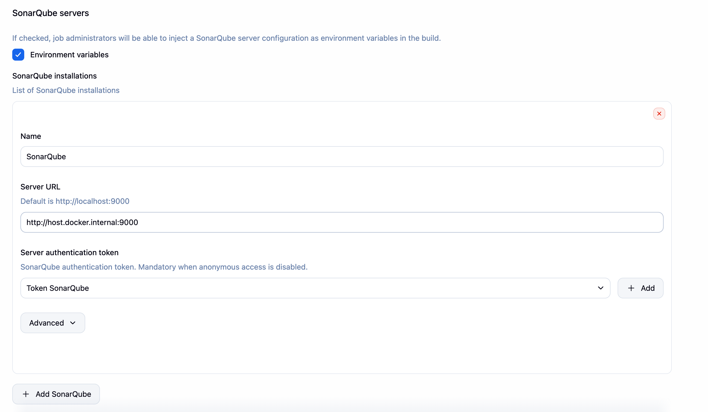

**Webhook.** Pour le Quality Gate, `waitForQualityGate` attend que SonarQube prévienne Jenkins, via un webhook vers `http://host.docker.internal:8080/sonarqube-webhook/`. Sans lui, le stage attend 5 minutes puis est annulé (c'est ce qui s'est passé au build n°5).

Problème : à la création, SonarQube a refusé l'URL, car les adresses de réseau privé sont interdites par défaut.

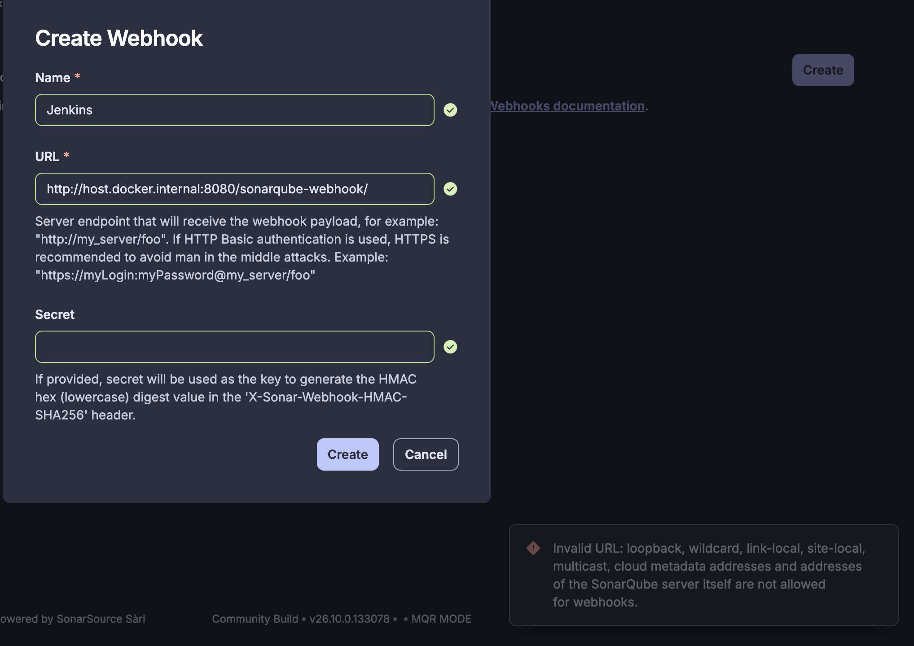

Solution : j'ai recréé le conteneur SonarQube avec `SONAR_VALIDATEWEBHOOKS=false`, via un fichier de surcharge, sans toucher à son Compose et en gardant ses volumes. Cette vérification protège contre l'envoi de requêtes vers des services internes : la désactiver est acceptable sur mon environnement local, pas en production.

### 6. Image Docker et Trivy

Le Dockerfile a deux étapes. L'image finale ne contient que `dist`, `prisma` et les dépendances de production. Trivy fait échouer la pipeline s'il trouve une vulnérabilité **CRITICAL** corrigeable. Les HIGH sont notées dans le rapport mais ne bloquent pas.

**La base de données n'est pas dans l'image.** L'image ne contient que l'API. PostgreSQL est un service à part, auquel l'API se connecte avec `DATABASE_URL`. Les raisons :

- les données doivent survivre aux déploiements, alors qu'une image est remplacée à chaque build : elles iront dans un volume persistant ;
- aucune donnée ni aucun identifiant de base dans l'image ;
- la même image sert partout, il suffit de changer `DATABASE_URL` ;
- on peut revenir à une ancienne version de l'API sans toucher aux données (limite : un retour arrière ne garantit pas celui du schéma, les migrations devront en tenir compte).

La CI n'a donc pas besoin de base, puisque les tests simulent Prisma. PostgreSQL n'arrive qu'au déploiement (partie 2), avec Docker Compose : un service pour l'API, un pour PostgreSQL, un réseau Docker et un volume.

**L'incident Trivy.** Au build n°6, Trivy a bloqué la publication : 2 vulnérabilités CRITICAL. Le Stage View montre Trivy Scan en échec et Publish sauté :

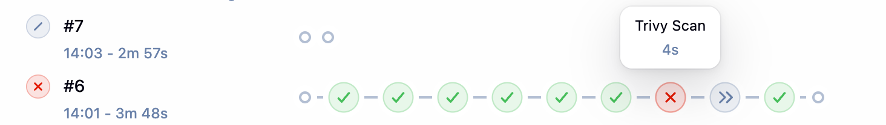

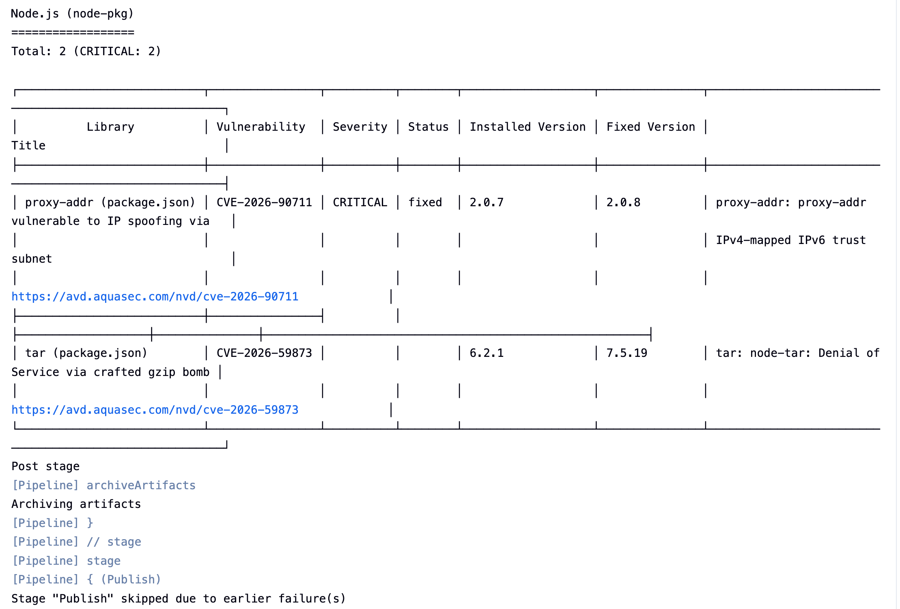

- `proxy-addr` 2.0.7 (dépendance d'Express) : mis à jour en 2.0.8.
- `tar` 6.2.1 : il était embarqué dans `npm`, livré avec l'image `node:20-alpine`. Comme l'API n'a pas besoin de `npm` pour tourner, je l'ai retiré de l'image finale.

Le build suivant est passé jusqu'à la publication.

### 7. Pipeline

Les étapes : Build, Test, Quality, Quality Gate, Docker Build, Trivy Scan, Publish (schéma dans `documentation/architecture.md`). Chaque étape bloque la suivante : l'image n'est publiée que si tout est vert.

Dans Jenkins, le dernier succès est le build n°8 (4 min 39 s) et le dernier échec est le n°6, celui de Trivy :

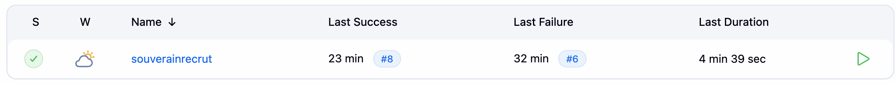

Les 9 étapes du build n°8 sont vertes (checkout, les 7 stages et les actions finales) :

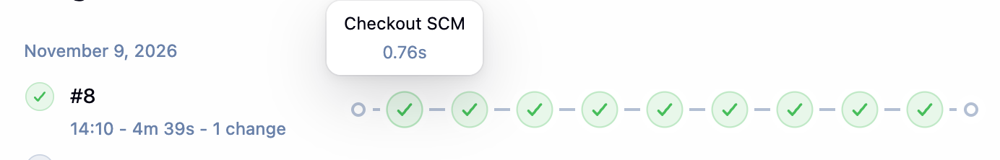

L'image est publiée sur Docker Hub, dépôt public `jackylp/souverainrecrut-backend`, avec les tags `8` (numéro de build) et `latest`. Les deux ont le même digest, `sha256:0ad9820992752720ee2007e27efe0219a27822851fc08cc01530c3cc26f01c32`, comme dans le journal du build.

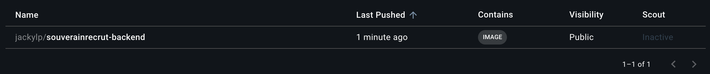

### 8. Résultats

Dernière analyse SonarQube du backend, Quality Gate **OK** :

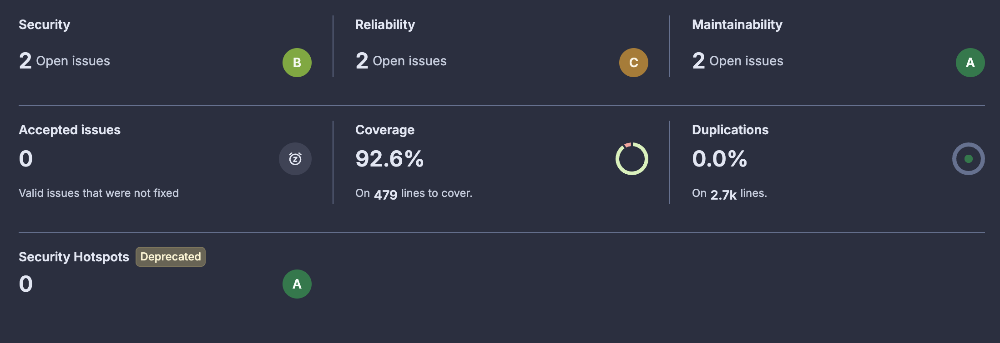

| | État des lieux | Résultat final |
|---|---|---|
| **Couverture** | 0,0 % | **92,6 %** |
| **Duplication** | 10,8 % | **0,0 %** |
| Sécurité | 2 issues (B) | 2 issues (B) |
| Fiabilité | 16 issues (C), frontend compris | 2 issues (C) |
| Maintenabilité | 2 issues (A) | 2 issues (A) |

Les issues restantes, que je n'ai pas corrigées :

- **Sécurité :** l'image tourne avec l'utilisateur `root` (`docker:S6471`) et Express expose l'en-tête `X-Powered-By` (`typescript:S5689`).
- **Fiabilité et maintenabilité :** deux `parseInt` à remplacer par `Number.parseInt` dans `backend/src/utils/pagination.ts` (`typescript:S7773`). Ces deux issues comptent dans les deux domaines.

Le détail est dans `integration-continue/reports/resume-resultats.md`.

### 9. Reproductibilité

Tout peut être rejoué à partir du dépôt :

- **Jenkins** : `docker compose -f integration-continue/docker-compose.yml up -d --build`. L'image Jenkins et ses plugins sont décrits dans des fichiers (`Dockerfile`, `plugins.txt`).
- **Pipeline** : le `Jenkinsfile` est versionné, et chaque étape tourne dans un conteneur avec une version définie.
- **Tests et scan en local** : `cd backend && npm ci && npx prisma generate && npm test`, puis la commande du scanner donnée dans `integration-continue/README.md`.
- **Réglages à faire une fois dans Jenkins** (credentials, serveur SonarQube, webhook, job) : tout est décrit pas à pas dans le même README.
- **Secrets** : aucun dans le dépôt. Il faut recréer `sonar-token` et `dockerhub-credentials` dans Jenkins.

À savoir : SonarQube n'est pas décrit dans ce dépôt (il tourne avec un autre Compose, démarré avec `SONAR_VALIDATEWEBHOOKS=false`), et le scanner SonarQube utilise le tag `latest`, alors que Trivy est épinglé par digest.

## Partie 2 : Provisionnement et déploiement (jour 2)

### 1. Accès au serveur

Le serveur n'est pas exposé sur internet. Je passe par Tailscale (VPN mesh), qui lui attribue une IP privée. les runners GitLab CI tournent sur gitlab.com : Ils accèdent au serveur via Tailscale.

### 2. Terraform

Terraform pilote le Docker du serveur **à distance**, en SSH, avec le provider `kreuzwerker/docker`. Il crée deux ressources persistantes sur le serveur :
- un réseau Docker `souverainrecrut-net` (bridge)
- un volume Docker `souverainrecrut-postgres-data`

Il génère aussi l'inventaire Ansible (`deploiement/ansible/inventory.ini`) à partir des variables Terraform. Les valeurs propres à mon installation sont dans `terraform.tfvars`, exclu du dépôt. Il contient cinq variables, toutes déclarées dans `variables.tf` : `server_host`, `ssh_user`, `ssh_port`, `ssh_private_key_path` et `app_name`.

`terraform apply` se lance depuis mon Mac, une seule fois, puis le réseau et le volume restent entre les déploiements.

`terraform init` télécharge les deux providers (`kreuzwerker/docker` et `hashicorp/local`) et fige leurs versions dans `.terraform.lock.hcl` :

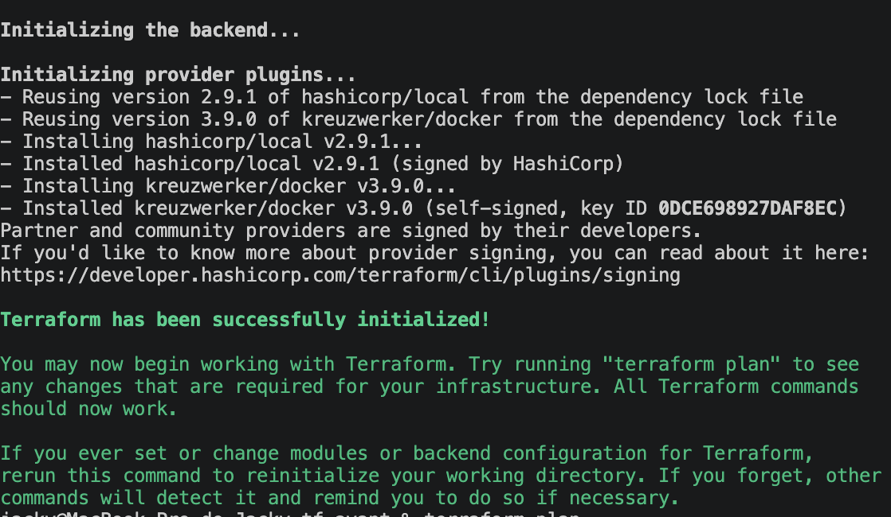

`terraform validate` confirme que la configuration est correcte :

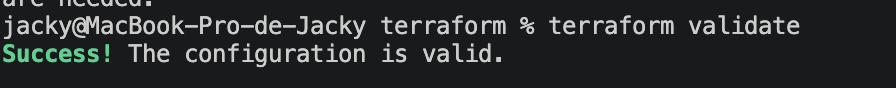

`terraform plan` annonce ce que Terraform va créer : 3 ressources, le réseau, le volume et l'inventaire Ansible.

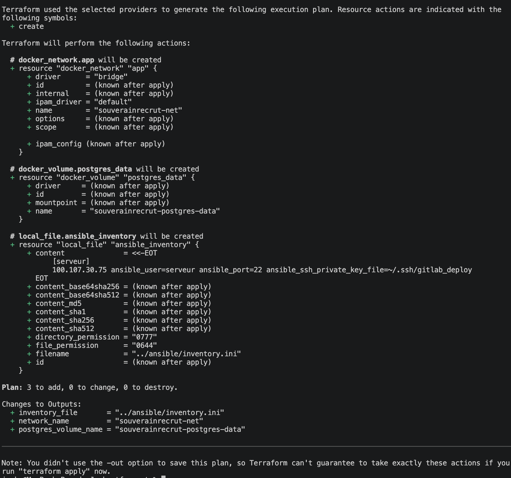

`terraform apply` crée le réseau, le volume et l'inventaire, et affiche leurs noms en sortie. La capture est prise après l'application : Terraform constate que l'infrastructure correspond déjà à la configuration.

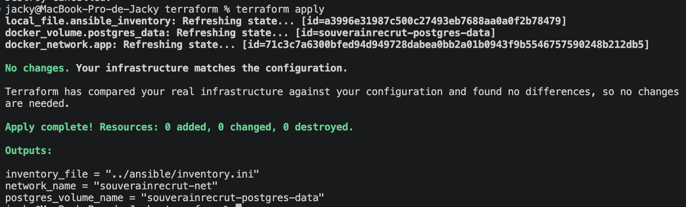

Un second `terraform plan` ne trouve aucune différence :

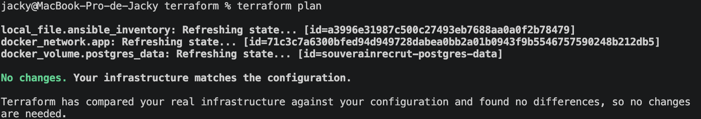

Sur le serveur, `docker volume ls` montre le volume créé par Terraform :

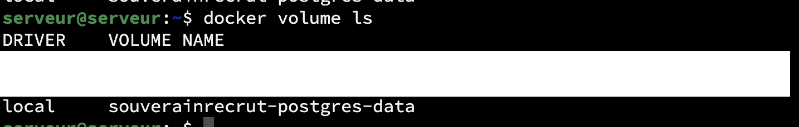

### 3. Ansible

Ansible prépare le serveur :
- mise à jour des paquets (`apt upgrade`) ;
- installation de Docker Engine et du plugin Compose (`docker.io`, `docker-compose-v2`), si absents ;
- activation du service Docker ;
- ajout de l'utilisateur de déploiement au groupe `docker` ;
- création du répertoire `~/deployment`.

Commande : `ansible-playbook -i deploiement/ansible/inventory.ini deploiement/ansible/playbook.yml`

Le playbook vérifie à la fin que Docker est actif et affiche les versions installées.

Voici la première exécution : 3 tâches modifient le serveur (cache apt, paquets, répertoire de déploiement). L'installation de Docker est ignorée (`skipping`) parce qu'il est déjà présent. Il n'y a aucun échec.

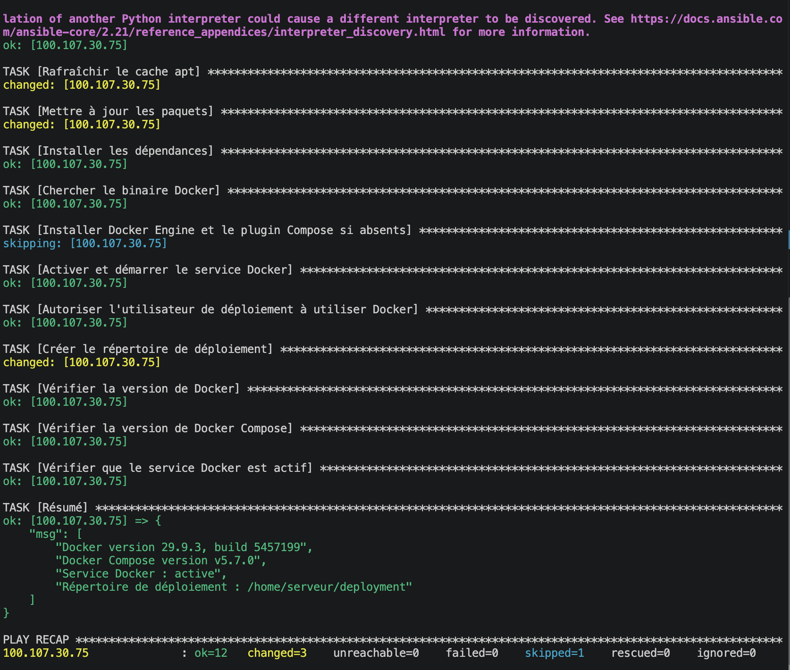

Je relance ensuite le playbook pour vérifier qu'il peut être rejoué sans danger. Le nombre de tâches modifiées passe de 3 à 2, l'installation de Docker reste ignorée et il n'y a aucun échec.

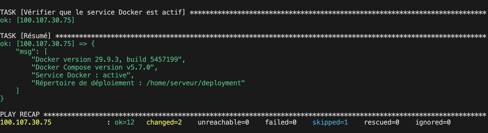

### 4. GitLab CI/CD

La pipeline est dans `deploiement/.gitlab-ci.yml`. Elle ne tourne que sur `main`, avec trois stages :

**validate_tag** : vérifie que la variable `IMAGE_TAG` est présente, valide et pointe vers un tag qui existe sur Docker Hub. Le tag `latest` est interdit : il ne permet pas de savoir quelle version tourne.

**deploy** (approbation manuelle) : se connecte au serveur via Tailscale + SSH. La clé SSH est stockée en base64 dans une variable GitLab masquée. Le job :
- copie `docker-compose.yml` et les fichiers Prisma sur le serveur ;
- crée le fichier `.env` avec les secrets (jamais versionné) ;
- fait `docker login`, `docker compose pull` ;
- démarre PostgreSQL, attend qu'il soit sain ;
- applique les migrations Prisma avec un conteneur éphémère (`profil migrate`) ;
- démarre le backend.

L'approbation manuelle protège contre un déploiement accidentel.

**verify** : attend que `/v1/health` réponde sur le serveur (12 tentatives, 5 s d'intervalle). En cas d'échec, affiche les 50 dernières lignes des logs du backend.

Toutes les variables sensibles (secrets, tokens, identifiants, clé SSH) sont dans GitLab CI/CD Variables. Les valeurs ne s'affichent pas, ni dans les réglages, ni dans les logs. GitLab ne peut pas masquer une valeur de moins de 8 caractères : `SERVER_USER` et `DOCKERHUB_USER` sont donc seulement protégées, ce qui est acceptable pour un nom d'utilisateur. Les variables marquées `Protected` ne sont disponibles que sur les branches protégées, ici `main`, la seule branche sur laquelle la pipeline tourne.

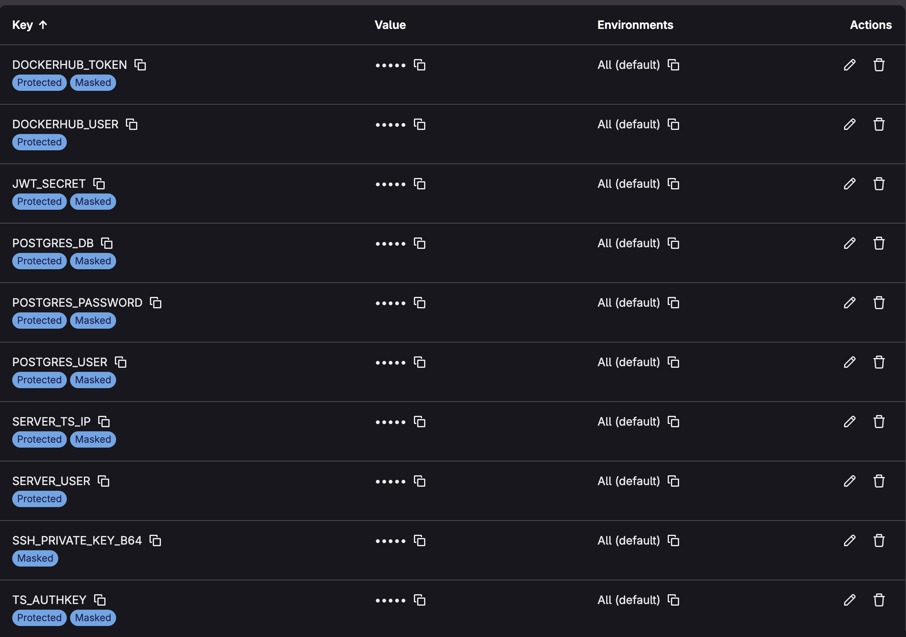

Voici la fin du log du job `deploy` : connexion à Docker Hub, téléchargement des images, migrations Prisma, puis démarrage des conteneurs. Les noms que GitLab a masqués apparaissent sous la forme `[MASKED]`. Sur ce déploiement, les migrations étaient déjà appliquées : Prisma indique `No pending migrations to apply`.

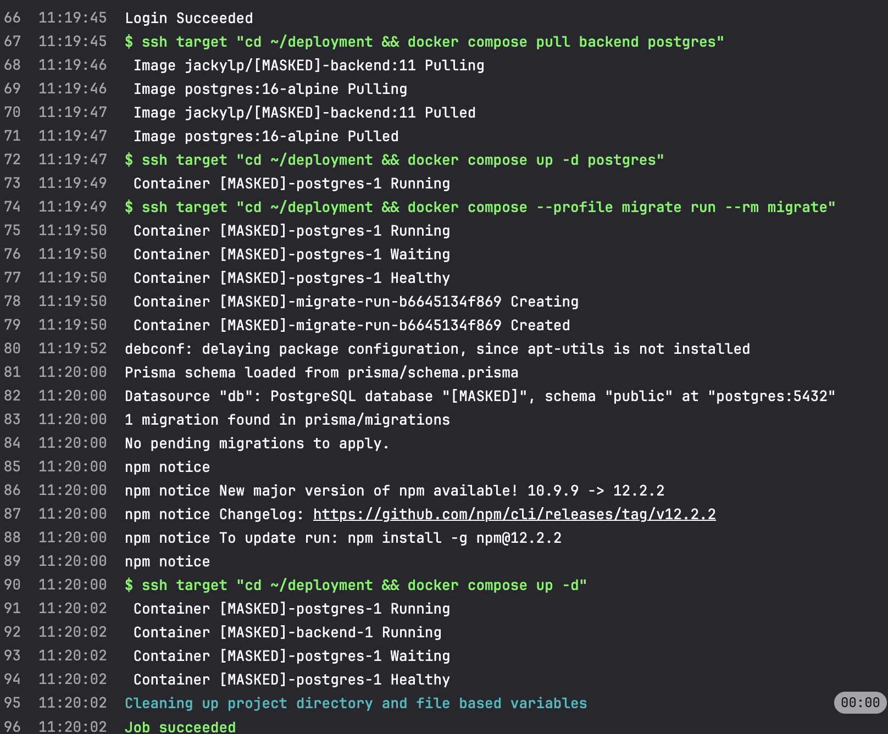

Les trois jobs du pipeline sont passés. Le job `deploy` a été lancé à la main avec le bouton de lecture :

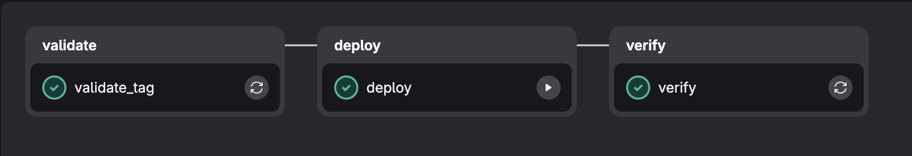

### 5. Résultats

Le déploiement fonctionne : l'API répond sur le serveur, PostgreSQL est sain, les migrations sont appliquées.

L'endpoint de santé répond `UP` en environnement `production`, depuis mon navigateur, à travers Tailscale :

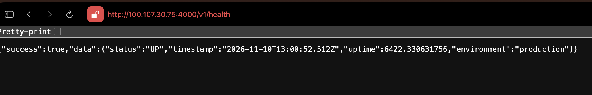

Sur le serveur, les deux conteneurs tournent avec la bonne image et sont `healthy` :

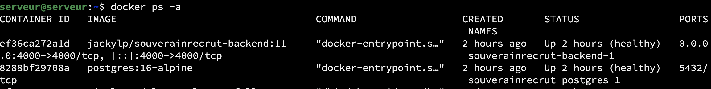

Deux relevés que j'ai faits en ligne de commande sur le serveur :

```
GET /v1/ready -> {"success":true,"data":{"status":"READY","database":"CONNECTED", ...}}

Tables créées par les migrations : users, candidates, jobs, applications, _prisma_migrations
```

`/v1/ready` confirme que l'API est connectée à PostgreSQL.

Le tag déployé est le `11` : c'est le premier build amd64 utilisable. Les builds `8` et `9` avaient été construits sur mon Mac en arm64 et ne démarrent pas sur le serveur.

### 6. Persistance des données et rollback

**Persistance.** Je vérifie que les données survivent quand les conteneurs sont supprimés. Il n'y a pas de route d'inscription, et toutes les routes demandent une connexion. J'ai donc inséré un utilisateur de test directement dans PostgreSQL, puis je suis passé par l'API : connexion, puis création d'une offre. Ensuite je supprime et je recrée les conteneurs, sans l'option `-v` qui supprimerait le volume.

```
Avant   POST /v1/jobs : offre créée, id cmwbvtpmm0001qh01er0rb22t
        GET /v1/jobs : 1 offre, "Test de persistance"
        docker compose down : conteneurs supprimés
        docker volume ls : souverainrecrut-postgres-data toujours présent
        docker compose up -d : backend et postgres healthy
Après   GET /v1/ready : READY, base CONNECTED
        GET /v1/jobs : 1 offre, même id cmwbvtpmm0001qh01er0rb22t
```

L'offre est toujours là, avec le même identifiant : le volume conserve les données. J'ai ensuite supprimé l'offre et l'utilisateur de test. Il faut supprimer l'offre d'abord, car la base interdit de supprimer un utilisateur qui a encore des offres. La base est revenue à zéro utilisateur et zéro offre.

**Rollback.** Je n'ai qu'un seul tag amd64 sur Docker Hub (le `11`). Pour tester, j'ai construit une seconde image en local (`12-test`), envoyée sur le serveur sans passer par Docker Hub. J'ai déployé le `12-test`, puis je suis revenu au `11` avec les commandes de la procédure manuelle. L'image du conteneur change puis revient à l'image d'origine, et l'API répond `UP` et `READY` à chaque étape. Le détail est dans `documentation/procedure-rollback.md`.

Ce test est fait à la main sur le serveur : je n'ai pas relancé le pipeline GitLab avec un ancien `IMAGE_TAG`. Je n'ai pas automatisé le rollback : le cahier demande de le documenter et de le tester.

### 7. Reproductibilité

Pour refaire le déploiement sur un autre serveur Ubuntu en amd64, il faut :

1. Un serveur accessible en SSH et en Tailscale, une clé SSH de déploiement, et Terraform et Ansible sur le poste de travail.
2. Créer `deploiement/terraform/terraform.tfvars` avec cinq valeurs : `server_host`, `ssh_user`, `ssh_port`, `ssh_private_key_path`, `app_name`.
3. `terraform init`, `validate`, `plan`, `apply` dans `deploiement/terraform/`.
4. `ansible-playbook -i inventory.ini playbook.yml --ask-become-pass` dans `deploiement/ansible/`.
5. Dans GitLab, régler le fichier de pipeline sur `deploiement/.gitlab-ci.yml` et créer les dix variables CI/CD listées dans `documentation/procedure-deploiement.md`.
6. Lancer un pipeline sur `main` avec `IMAGE_TAG` réglé sur un tag amd64 publié par Jenkins, puis cliquer sur `deploy`.
7. Vérifier `/v1/health` et `/v1/ready`.

Le détail de chaque étape, avec les erreurs rencontrées et leurs solutions, est dans `documentation/procedure-deploiement.md`. Les fichiers `terraform.tfvars`, `terraform.tfstate` et les `.env` ne sont pas dans le dépôt : ils sont à recréer.